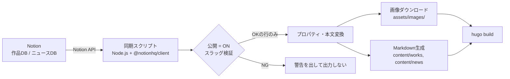

# 設計書：Notionデータ連携（トラックB）

**対象タスク:** T1-1〜T1-4（Phase 1. Notionデータ連携基盤）
**参照元:** [task.md](../task.md) / [要件定義書.md](./要件定義書.md)（F-101, F-102）
**Version:** 2.0（既存の作品DB・ニュースDBをそのまま使う構成に改訂。MVP実装向け）

**方針:** 本設計書は仕様・構造の定義を目的とし、実装コードは含めない。実装は [`scripts/notion-sync/`](../scripts/notion-sync/) にあり、本設計書を仕様として参照する。

> 公開リポジトリのため、Notion側のページ名・階層・URL・DB IDは記載しない。列名・型・変換ルールのみを定義する。

---

## 0. 全体データフロー



- 同期は**ローカルで1コマンド**（`npm run sync`）で実行できる。CIへの組み込み（cron・ビルド前ステップ）はトラックCが担当する。
- 生成物は**ビルド直前の一時データ**として扱う（4.7節・6章）。
- 画像のダウンロードは、Notionの署名付きURLが有効なうちに、レコード取得と同一プロセス内で完結させる（URLは約1時間で失効するため）。

### 同期対象

| 対象 | 同期 | 備考 |
| --- | --- | --- |
| 作品DB | する | 出力先 `content/works/` |
| ニュースDB | する | 出力先 `content/news/` |
| ヒーロー・プロフィール等 | しない | MVPではリポジトリ内のファイル（`params.toml`・`content/about.md` 等）で管理する |
| シリーズ・楽曲・イラスト・サークル・イベント等 | しない | バックログ（作品への埋め込みは行わない） |

---

## 1. T1-1. Notionデータベース設計（列定義）

新規DBは作らず、**既存の作品DB・ニュースDBの列のうち、必要なものだけ**を同期する。ここに列挙しない列は読まない（出力しない）。

### 1.1 共通ルール

- **公開**（チェックボックス）がONの行だけを対象にする。Notion API側のfilterで絞り込み、OFFの行は取得しない。
- **スラッグは必須。** ONの行でも、次のいずれかに該当する行は**警告を出して出力しない**（ビルド全体は止めない）。
  - スラッグが空
  - 形式違反（使える文字は英小文字・数字・ハイフンのみ。先頭・末尾のハイフン、連続ハイフンは不可）
  - 同一DB内で重複（先に処理した行を採用し、2件目以降を警告のうえ除外）
- **日付は必須。** 日付が空の行も警告して出力しない。
- 空の値はフロントマターに出力しない（`image` 等）。

### 1.2 作品DB

| 列名 | Notion型 | 必須 | 出力先 | 変換ルール |
| --- | --- | --- | --- | --- |
| タイトル | タイトル | ○ | `title` | そのまま |
| スラッグ | テキスト | ○ | ファイル名 `<スラッグ>.md`・画像名 | 1.1節の検証を通ったものだけ |
| 公開 | チェックボックス | ○ | （フィルタ） | ONのみ取得。出力時は `draft: false` |
| 頒布日 | 日付 | ○ | `date` | `YYYY-MM-DDT00:00:00+09:00` |
| 種別 | セレクト | ○ | `categories: ["<種別>"]` | ギャラリーの絞り込みボタン（F-303）に使う。空なら `categories` を出力しない |
| 説明文 | テキスト | — | `description` | 空なら出力しない |
| カバー画像 | ファイル | — | `image` | 先頭の1点のみ使う。4章に従いダウンロード |
| （ページ本文） | ブロック | — | Markdown本文 | 3.4節の変換対象 |

**同期しない列（MVP外）:** ギャラリー画像、サイト公開日、サークル、シリーズ、ジャンル、初回頒布イベント、収録イラスト、収録曲、形態、旧PublicId、旧作品、構成、紹介URL、表示順、販売状況、頒布先。

> ジャンル・形態・構成などは通常のフロントマター項目として出す案もあったが、絞り込みボタンには使わないため、MVPでは出力しない。必要になった時点で追加する。

### 1.3 ニュースDB

| 列名 | Notion型 | 必須 | 出力先 | 変換ルール |
| --- | --- | --- | --- | --- |
| タイトル | タイトル | ○ | `title` | そのまま |
| スラッグ | テキスト | ○ | ファイル名 `<スラッグ>.md`・画像名 | 1.1節の検証を通ったものだけ |
| 公開 | チェックボックス | ○ | （フィルタ） | ONのみ取得。出力時は `draft: false` |
| 掲載日 | 日付 | ○ | `date` | `YYYY-MM-DDT00:00:00+09:00` |
| 要約 | テキスト | — | `description` | 一覧表示用。空なら出力しない |
| サムネイルURL | URL（現状）／ファイル | — | `image` | 4章に従いダウンロード。列の型は URL・ファイルのどちらでも読める |
| （ページ本文） | ブロック | — | Markdown本文 | 3.4節の変換対象 |

**同期しない列（MVP外）:** カテゴリ、リンクURL、関連作品。

> 画像列は、運用上Notionにアップロードする方式（ファイル型）への変更が予定されている。スクリプトは列の型（ファイル／URL）を見て同じ処理で扱うため、型を変えても設計は変わらない。列名を変更する場合は、設定（`scripts/notion-sync/src/schema.mjs`）を合わせて直す。

---

## 2. T1-2. Notion Integration作成・API接続

### 2.1 Integration作成手順

1. Notionのインテグレーション管理画面で **Internal Integration** を新規作成する（Publicにはしない）。
2. Capabilities（権限）は **Read content** のみ付与する。Insert／Update／Commentは付与しない（同期は読み取り専用）。
3. 発行された **Internal Integration Secret** を控える。
4. Integrationを共有する範囲は**作品DBとニュースDBの2つだけ**にする。各DBの「Connections」から個別に追加する。他のDBや親ページには共有しない（子ページへ権限が継承されるため）。
5. 各DBのIDを控える（DBを開いたURLに含まれる32文字のID）。

### 2.2 シークレット・環境変数

| 変数名 | 用途 | ローカル | CI |
| --- | --- | --- | --- |
| `NOTION_API_KEY` | Integration Secret | `.env` | GitHub Secrets |
| `NOTION_WORKS_DB_ID` | 作品DBのID | `.env` | GitHub Secrets または Variables |
| `NOTION_NEWS_DB_ID` | ニュースDBのID | `.env` | GitHub Secrets または Variables |

- `.env` は `.gitignore` 済み。リポジトリには、値を空にした `.env.example` のみを置く。
- APIキー・DB IDをコード・ログ・コミット履歴に残さない（ログにも出力しない）。

### 2.3 データ取得処理

- **ライブラリ:** `@notionhq/client`（公式SDK、T0-3の決定どおり）。Node.js 24。
- 取得は **データソース単位** で行う。DB IDから `databases.retrieve` でデータソースIDを解決し、`dataSources.query` を実行する。
  - `filter`: `公開` チェックボックス = true
  - ページネーション（`has_more` / `next_cursor`）をすべて辿る
- 各ページの `properties` は、列名をキーにして、型ごとの正規化関数（title / rich_text / select / date / checkbox / files / url）でプレーンな値に変換する。列の型が想定と違う場合は、その行を警告して飛ばす。
- 本文は `blocks.children.list` を再帰的に呼び、3.4節の変換へ渡す。

### 2.4 レート制限・エラー処理

| 事象 | 扱い |
| --- | --- |
| 429（レート制限） | `Retry-After` に従って待機し、最大5回リトライ（待機は指数的に増やす） |
| 5xx・ネットワーク一時エラー | 同様にリトライ |
| 1件の変換・取得失敗 | その行だけ警告して飛ばし、処理を続ける |
| 画像ダウンロード失敗 | 4.8節。その画像だけ飛ばす |
| 認証エラー（401）・DBに接続できない（403/404） | **ジョブ失敗**（非ゼロ終了）。後続のビルド・デプロイに進ませない |
| 必須の環境変数が未設定 | ジョブ失敗（非ゼロ終了） |

終了時に、出力件数・警告件数・除外された行（タイトルと理由）を一覧で表示する。警告があっても終了コードは0（ビルドは止めない）。

---

## 3. T1-3. Hugo Content変換仕様

### 3.1 出力ファイル

| 種類 | パス |
| --- | --- |
| 作品 | `asnomi-kross-mock/content/works/<スラッグ>.md` |
| ニュース | `asnomi-kross-mock/content/news/<スラッグ>.md` |

- 一覧ページの設定 `_index.md` は**上書き・削除しない**。
- 同期のたびに、そのディレクトリ内の「同期が作ったファイル」を作り直す。作ったファイルは出力先ごとの管理リスト（`.sync-manifest.json`）に記録し、次回実行時に、リストにあって今回出力しなかったもの（公開OFFにされた等）を削除する。リストに無いファイル（`_index.md`、手書きのサンプルなど）には触れない。

### 3.2 フロントマター

現行のモックと同じ形（YAML）。値は常にダブルクォートで囲み、`"` と `\` はエスケープする。

作品:

```yaml
---
title: "<タイトル>"
date: <YYYY-MM-DD>T00:00:00+09:00
image: "images/works/<スラッグ>.<拡張子>"
categories: ["<種別>"]
description: "<説明文>"
draft: false
---
```

ニュース:

```yaml
---
title: "<タイトル>"
date: <YYYY-MM-DD>T00:00:00+09:00
description: "<要約>"
image: "images/news/<スラッグ>.<拡張子>"
draft: false
---
<本文>
```

- `image` `description` `categories` は値がある場合のみ出力する。
- 日付は日付部分（`YYYY-MM-DD`）のみを使い、時刻は常に `T00:00:00+09:00` とする。日時指定の場合も日付部分だけを採用する。

### 3.3 ファイル名

`<スラッグ>.md`。スラッグの検証（1.1節）を通ったものだけが出力されるため、ファイル名に使える文字だけで構成される。

### 3.4 本文（ブロック → Markdown）

| ブロック | Markdown |
| --- | --- |
| 段落 | 段落（前後に空行） |
| 見出し1〜3 | `##` `###` `####`（ページタイトルがh1のため1段下げる） |
| 箇条書き | `- ` |
| 番号付きリスト | `1. ` |
| 入れ子のリスト | 2スペースインデントで表現 |
| 画像 | ``、画像は4章どおりダウンロード |
| リッチテキストの装飾 | 太字 `**`・斜体 `*`・取り消し線 `~~`・インラインコード `` ` `` ・リンク `[text](url)` |
| 上記以外 | **警告を出して飛ばす**（ブロック種別とスラッグを表示） |

- 本文内画像のパスは、フロントマターと同じく `assets/images/` からの相対（`images/...`）で書く。Markdown上では、Hugoの画像描画フック（`render-image`）が `assets/` を参照できるようになっているかをトラックAと確認する（5章）。
- Markdown記号のエスケープは最小限とする（行頭の `#` `-` `>` 等と、`*` `_` `` ` `` `[` `]`）。

### 3.5 Dataファイル

サイト設定（ヒーロー等）の `data/` 出力はMVPでは行わない（0章）。

---

## 4. T1-4. 画像のローカル永続化処理

### 4.1 課題

Notionにアップロードした画像のURLは署名付きで、**約1時間で失効する**。そのままHugoに渡すと、ビルドの1時間後にリンク切れになる（F-102）。

### 4.2 処理タイミング

レコード取得の直後、同一プロセス内でダウンロードを完了する。URLを保存したり後続ステップへ引き渡したりしない。

### 4.3 保存先・参照パス

`assets/images/` に保存する（**確定**）。Hugoの画像処理（リサイズ・WebP変換、NF-102）を使えるようにするため、`static/` ではなく `assets/` とする。

| 種類 | 保存先（`asnomi-kross-mock/` 配下） | フロントマター上の参照 |
| --- | --- | --- |
| 作品のカバー画像 | `assets/images/works/<スラッグ>.<拡張子>` | `images/works/<スラッグ>.<拡張子>` |
| ニュースの画像 | `assets/images/news/<スラッグ>.<拡張子>` | `images/news/<スラッグ>.<拡張子>` |
| 本文中の画像 | `assets/images/<works or news>/<スラッグ>-<連番>.<拡張子>` | `images/<works or news>/<スラッグ>-<連番>.<拡張子>` |

- 連番は本文中の画像の出現順（1始まり）。
- 拡張子は、レスポンスの `Content-Type` を優先し、判定できなければURLのパス末尾から決める。対応: jpg・png・gif・webp・avif・svg。それ以外は警告して飛ばす。
- 1つの列に複数ファイルがある場合は先頭のみ使う（ギャラリー表示はバックログ）。

### 4.4 ダウンロード仕様

1. 列の値（ファイルの署名付きURL、またはURL型の値）に対してHTTP GETを行う。
2. タイムアウトは30秒。失敗した場合は最大3回リトライする。
3. 取得したバイトを保存先に書き込む。同名ファイルがあれば上書きする。
4. ダウンロードしたパスを3章のMarkdown生成へ渡す。

### 4.5 リンク切れ防止

- フロントマターの `image` と本文中の画像は、Notionの元URLを一切使わず、**常にローカルのパスのみ**を出力する。
- ダウンロードに成功した画像だけを参照する（失敗した場合は `image` を出力しない、または画像ブロックを飛ばす）。

### 4.6 容量

Notion無料プランは1ファイル5MBまで。画像はWeb用に縮小したものをNotionに置く運用を前提とする。ダウンロード後の画像はHugoの画像処理で配信用に最適化される（NF-102）。将来、容量制限によりS3等へ移行する場合はバックログ。

### 4.7 再実行時の扱い

- 管理リスト（`.sync-manifest.json`）に、画像も記録する。公開OFFや差し替えで不要になった画像は、次回実行時に削除する。
- 差分ダウンロード（`last_edited_time` による変更検知）は、MVPでは行わない。現在の件数ではダウンロード時間・APIレート内に収まる想定で、T5-1の結合テストで実測し、必要になった場合のみ導入する。

### 4.8 異常系

- ダウンロードに失敗（タイムアウト・404・容量超過等）した場合は、その画像だけ警告して飛ばす。`image` は出力せず、**同期全体は止めない**。

---

## 5. 未確定事項・他トラックとの調整

- **本文中の画像描画（トラックA）:** 3.4節の `` を、Hugoが `assets/` から解決して表示できること（`render-image` フック等）を確認する。MVPで本文に画像を入れない運用なら不要。
- **サンプルコンテンツの切り替え（トラックA・C）:** 6章の提案を参照。
- **ニュースの画像列:** 現状はURL型。ファイル型への変更後も、列名が変わらなければスクリプトの修正は不要。
- **差分ダウンロード:** T5-1の実測後に判断する。
- **NEW判定・サイト公開日:** スコープアウト済み（F-103・F-305）。

---

## 6. 既存サンプルコンテンツとの切り替え方（提案）

現在 `content/works/`（3点）と `content/news/`（3件）にトラックAのサンプルがコミットされている。同期で生成されるファイルと二重にならないよう、次のように切り替える。

### 6.1 方針

- 同期の生成ファイルは**コミットしない**（`.gitignore` で除外）。サンプルは同期を有効にするまで残す。
- 同期スクリプトは、管理リスト（`.sync-manifest.json`、コミットしない）にある自分が作ったファイルだけを入れ替える。**管理リストに無いサンプルには触れない**ため、サンプルと同期結果は共存できる。

### 6.2 切り替え手順

1. 同期を有効にする前に、サンプルのスラッグ（`aotaiken` 等）と同じスラッグの行をNotionで公開ONにしない（同名ファイルは同期側が**出力せず警告する**。サンプルを上書きしない）。
2. 本番運用に切り替えるPRで、次を同時に行う（トラックA・Cと合意のうえ）。
   - サンプルの `works/*.md` `news/*.md`（`_index.md` を除く）と、それに対応するサンプル画像を削除する。
   - `.gitignore` に、生成ファイルのパターンを追加する（下記）。
   - ワークフローに同期ステップを追加し、環境変数を渡す（トラックC）。
3. 同期の生成物は、次の場所に出る（すべて `.gitignore` 対象）。

```
asnomi-kross-mock/content/works/*.md        # _index.md は除外しない設定にする（下記）
asnomi-kross-mock/content/news/*.md
asnomi-kross-mock/assets/images/works/
asnomi-kross-mock/assets/images/news/
asnomi-kross-mock/.sync-manifest.json
```

> `.gitignore` では `content/works/*.md` と `!content/works/_index.md` を併記して、`_index.md` だけを追跡対象に残す。サンプル画像（`assets/images/works/` 内）を残したい場合は、サンプル削除のタイミングで同時にこの除外を有効にする。

### 6.3 CIで必要な環境変数（トラックCへの引き渡し）

2.2節の3つ。`NOTION_API_KEY` は Secrets、DB IDは Variables でもよい。ワークフローは、サイトルート（`asnomi-kross-mock/`）ではなく**リポジトリ直下の `scripts/notion-sync/`** で `npm ci` → `npm run sync` を実行し、その後に `hugo` を実行する。

---

## 7. 実行方法（ローカル）

```
cd scripts/notion-sync
npm install
cp .env.example .env     # 値を設定する
npm run sync
```

- `npm run sync -- --dry-run`: ファイルを書かず、取得・検証・警告だけを表示する。
- 出力後、`asnomi-kross-mock/` で `hugo server` を起動して確認する。
