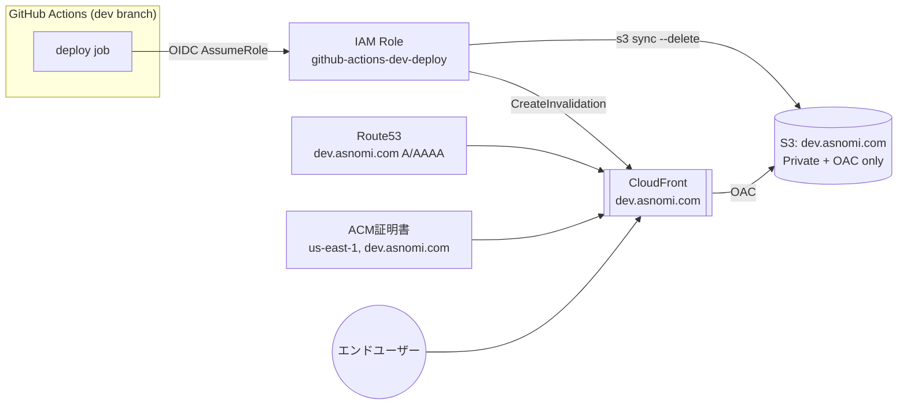

# 設計書：トラックD（インフラ / Terraform・非機能設計）

**対象タスク:** T3-4（ブランチ別マルチ環境デプロイ）のインフラプロビジョニング部分（検証環境: `dev.asnomi.com`）

**参照元:** [task.md](../task.md)（WBS） / [要件定義書.md](./要件定義書.md) / [設計書_トラックC_インフラCICD.md](./設計書_トラックC_インフラCICD.md)（トラックCへの払い出し先）

**対応要件:** F-204, NF-101, NF-202

**Document Version:** 0.5（9章「移行計画」を追加）

**Date:** 2026-08-30（初版）／2026-08-30改訂（terraform apply実行完了、実機構築結果を反映）／2026-10-23改訂（6.3〜6.4節追加）／2026-10-23再改訂（AssumeRole失敗の障害対応を反映）／2026-10-26改訂（9章追加）

---

## 0. 前提・スコープ

- 本書は検証環境（`dev.asnomi.com`）のAWSリソースをTerraformで構築するための設計書。
- 本番環境（`asnomi.com`）は既存の手動/CloudFormation構築のまま**変更しない**。今回作成するTerraformコードは本番環境を対象外とするが、`terraform/modules/static-site` は将来的に本番のTerraform化にも再利用できる構成にしてある。
- 実際の`terraform apply`実行はユーザー（インフラ管理者）が最終承認の上で行う。本書とコードは設計・実装であり、apply自体の実行タイミングは別途確認する。

---

## 1. 前提調査で判明した事実

Terraform設計にあたり、AWS CLI（読み取り専用コマンド）で現行環境を確認した。

| 項目 | 内容 |
| --- | --- |
| AWSアカウントID | `566759952246` |
| ドメイン | **`asnomi.com`**（要件定義書中の表記「asnoni.com」は誤字と判断し、本書以降は実際のドメイン`asnomi.com`で統一する） |
| Route53ホストゾーンID | `Z13MX47JV7ZFKX`（`asnomi.com.`） |
| 本番S3バケット | `asnomi.com` |
| 本番CloudFrontディストリビューション | `E3DNAV0NRDDLND`（エイリアス`asnomi.com`設定済み） |
| ACM証明書（`us-east-1`） | `arn:aws:acm:us-east-1:566759952246:certificate/0d3fbc67-1eb8-4c98-aca1-81ea2a81e0e4`、**`asnomi.com`単体のみでワイルドカードではない**（SAN確認済み） |
| **既存のオーファンリソース** | CloudFrontディストリビューション`EHAFG1OU9KCD7`（オリジン`dev.asnomi.com.s3.amazonaws.com`、エイリアス未設定）が存在。`CallerReference`が2020年頃のタイムスタンプであり、CloudFormationスタック一覧にも該当なし。オリジン先のS3バケット`dev.asnomi.com`は現存せず（404）、OAC/OAIも未設定。**2020年頃の検証作業の残骸と判断** |

### 1.1 対応方針（ユーザー確認済み）

- **既存の`EHAFG1OU9KCD7`は削除し、Terraform管理下の新規リソースに一本化する。**（オーファン化・セキュリティ設定が不十分なため）
  - 削除はCloudFront仕様上「無効化 → 反映待ち → 削除」の2段階操作が必要。**Terraform適用前に、AWSコンソール／CLIで別途明示的な承認を得たうえで実施する**（本書のコード変更には含まれない、実行時の別アクション）。
- **ACM証明書は`dev.asnomi.com`単体で新規発行する**（ワイルドカードではないため）。Route53 DNS検証をTerraformで自動化する。

---

## 2. 全体構成



**設計の骨子:**
- S3バケットは完全非公開（Block Public Access全ON）。CloudFrontの **Origin Access Control (OAC)** 経由のみアクセス許可。
- GitHub ActionsのAWS認証は**OIDC（長期アクセスキー不使用）**。リポジトリ（数値ID付き表記）とGitHub Environment（`dev`）を信頼ポリシーの`sub`で完全一致に限定し、ブランチはEnvironmentのDeployment branches設定で`dev`のみに限定する（6.3・6.5節参照）。キー漏洩リスクそのものを排除する。
- IAMロールの権限は対象S3バケット・対象CloudFrontディストリビューションのみに限定した最小権限。
- 本番（`asnomi.com`）・検証（`dev.asnomi.com`）は完全に別リソース（別S3バケット・別CloudFrontディストリビューション）とし、設定ミスの影響が本番に波及しない構成とする。

---

## 3. Terraformディレクトリ構成

```
terraform/
├── bootstrap/              # tfstate保存用S3+DynamoDB（最初の1回のみ、local stateで管理）
│   ├── main.tf
│   ├── variables.tf
│   └── outputs.tf
├── global/
│   └── github-oidc/        # GitHub Actions用IAM OIDCプロバイダ（アカウントに1つのみ、dev/prod共用）
│       ├── main.tf
│       ├── variables.tf
│       └── outputs.tf
├── envs/
│   ├── dev/                 # 検証環境の実体（S3リモートバックエンド管理）
│   │   ├── main.tf
│   │   ├── variables.tf
│   │   └── outputs.tf
│   ├── prod/                # 本番（asnomi.com）。9章の方針どおり新しいバケット・ディストリビューションを並行作成
│   └── rehearsal/           # ドメイン付け替えのリハーサル用の一時環境（リハーサル後にdestroy）
└── modules/
    └── static-site/          # 再利用可能モジュール（S3+CloudFront+ACM+DNS+IAMロール）
        ├── versions.tf
        ├── s3.tf
        ├── cloudfront.tf
        ├── acm.tf
        ├── dns.tf
        ├── iam.tf
        ├── variables.tf
        └── outputs.tf
```

`modules/static-site` は環境名・ドメイン名等をパラメータ化しており、`envs/dev`・`envs/prod`・`envs/rehearsal` から同じモジュールを呼び出す。本番向けに追加した入力は9.3節を参照。

---

## 4. Terraform state管理

- tfstateは **S3リモートバックエンド + DynamoDBロック** で管理する（ユーザー確認済み）。
- `terraform/bootstrap/` のみ、tfstate自体を保存する場所がまだ存在しないという鶏卵問題があるため、例外的にlocal stateで一度だけ実行する。
  - 生成される`terraform.tfstate`は`.gitignore`で除外済み。実行者（インフラ管理者）が個別に保管すること。
- 以降の`global/github-oidc`・`envs/dev`はS3バックエンド（バケット: `asnomi-terraform-state-566759952246`、ロックテーブル: `asnomi-terraform-state-lock`）を使用する。
- `envs/dev`は`terraform_remote_state`データソースで`global/github-oidc`の出力（OIDCプロバイダARN）を参照する。

---

## 5. セキュリティ設計

依頼の「キーが流出したらまずい」を踏まえ、以下を徹底する。

| 項目 | 対応 |
| --- | --- |
| AWS認証情報の長期保存 | **一切行わない。** GitHub ActionsはOIDCで一時クレデンシャルを都度取得する（`AWS_ACCESS_KEY_ID`等のSecretsは不要） |
| IAMロールの信頼範囲 | `sub`クレームを`StringEquals`で`repo:asnomi@81574932/ReFactory@1346288783:environment:dev`に完全一致限定（ワイルドカード不使用）。`aud`は`sts.amazonaws.com`。フォーク・同名の別リポジトリからは引き受け不可。ブランチ制限はGitHub `dev` EnvironmentのDeployment branches（`dev`のみ）で担保（6.3・6.5節） |
| IAMロールの権限範囲 | 対象S3バケットへの`PutObject`/`DeleteObject`/`ListBucket`、対象CloudFrontディストリビューションへの`CreateInvalidation`のみ（最小権限） |
| S3バケットの公開設定 | Block Public Access全項目ON。バケットポリシーはCloudFrontサービスプリンシパル（`SourceArn`条件で対象ディストリビューションに限定）からの`GetObject`のみ許可 |
| S3バケットの暗号化 | デフォルトSSE-S3（AES256）を有効化 |
| S3バケットのバージョニング | 有効化（`s3 sync --delete`による誤削除からの復旧用。トラックC設計書6章の推奨事項に対応） |
| CloudFrontの配信方式 | HTTPS必須（`redirect-to-https`）、TLS 1.2以上（`TLSv1.2_2021`） |
| Origin Access | OAC（Origin Access Control。旧式のOAIより推奨される最新方式）を使用 |

---

## 6. 適用手順・実行結果

**2026-08-30、ユーザー承認のうえ実行完了。** 以下、実施した手順と結果。

1. **既存オーファンリソースの削除** ✅ 完了
   - CloudFrontディストリビューション`EHAFG1OU9KCD7`を無効化 → `Deployed`状態を確認 → 削除。削除後`GetDistribution`で`NoSuchDistribution`を確認済み。
2. `terraform/bootstrap/` を apply ✅ 完了（tfstate用S3バケット・DynamoDBロックテーブル作成）
3. `terraform/global/github-oidc/` を apply ✅ 完了（OIDCプロバイダ作成）
   - **apply中に判明した不具合：** コード内の`thumbprint_list`が39文字（1文字不足）でTerraformのバリデーションエラーとなった。`openssl s_client`で`token.actions.githubusercontent.com`の実際のTLS証明書チェーンから中間CA証明書のSHA1フィンガープリントを取得し直し、正しい40文字の値に修正して解消（`terraform/global/github-oidc/main.tf`）。
4. `terraform/envs/dev/` を apply
   - **1回目：失敗。** S3バケット名を`domain_name`（`dev.asnomi.com`）とそのまま同一にしていたため、`BucketAlreadyExists`（S3バケット名はAWS全体でグローバルに一意な必要があり、他アカウントで既に使用済みだった）で失敗。ACM証明書・IAMロール・OACは作成成功。
   - **対応：** `modules/static-site`に`bucket_name`変数を新設し、`domain_name`（DNS/CloudFrontエイリアス用）とS3バケット名を分離。`envs/dev`では`bucket_name = "asnomi-dev-site-566759952246"`を使用するよう変更。
   - **2回目：成功。** 残りのS3バケット本体・CloudFrontディストリビューション・Route53レコード（A/AAAA）を作成し、apply完了。
5. 実機動作確認 ✅ 完了
   - DNS解決：`dev.asnomi.com` → CloudFrontのIPアドレス群に正しく解決
   - HTTPS/TLS：ハンドシェイク成功（ACM証明書が正しくバインドされている）
   - アクセス制御：コンテンツ未デプロイの状態で`403 AccessDenied`（S3非公開設定・OAC経由アクセス制御が正しく機能している証跡。公開バケットであればこの時点でエラー内容が異なる）

### 6.1 最終的なリソース出力値（トラックCへ払い出し）

| 出力名 | 値 |
| --- | --- |
| `bucket_name` | `asnomi-dev-site-566759952246` |
| `distribution_id` | `E14202WQ2RVGSJ` |
| `distribution_domain_name` | `d1cp5q5toxt6i0.cloudfront.net` |
| `deploy_role_arn` | `arn:aws:iam::566759952246:role/github-actions-dev-deploy` |
| `acm_certificate_arn` | `arn:aws:acm:us-east-1:566759952246:certificate/def86e2f-d231-4b50-9941-eb11f7c1a594` |

### 6.2 GitHubでの値管理方針（Variables、Secretsではない）

上記のうちトラックC（GitHub Actionsデプロイワークフロー）が使う3値を、**GitHubの`dev` Environment Variables**（Secretsではない）に登録する。

| 出力名 | 登録先（GitHub `dev` Environment Variables） |
| --- | --- |
| `bucket_name` | `S3_BUCKET_NAME` = `asnomi-dev-site-566759952246` |
| `distribution_id` | `CLOUDFRONT_DISTRIBUTION_ID` = `E14202WQ2RVGSJ` |
| `deploy_role_arn` | `AWS_DEPLOY_ROLE_ARN` = `arn:aws:iam::566759952246:role/github-actions-dev-deploy` |

トラックC側は[設計書_トラックC_インフラCICD.md](./設計書_トラックC_インフラCICD.md) 5.2節の単一環境前提のSecrets構成を、GitHub Environments機能でdev/prod別に分離する対応が必要（同設計書T3-4節に記載済み）。

- 上記3値は、いずれもAWSコンソールを見れば分かる非機密情報であり、かつIAMロールはOIDC信頼ポリシー（リポジトリ・ブランチ限定）で保護されているため、ARNが露出しても実害はない。そのため、GitHubの **Secrets ではなく Environment Variables**（`dev` Environment）に登録し、値の可視性・管理性を優先する。
- 真に機密な値（長期AWSアクセスキー等）は本設計に一切登場しない（5章参照）。したがって`dev` EnvironmentにSecretsを登録する必要はない。
- 登録作業は`gh` CLI未導入のため未実施。GitHub UIの Settings → Environments → `dev` → Variables から手動登録するか、`gh` CLI導入後に`gh variable set --env dev`で登録する（6.1節の値を使用）。
- `envs/dev`のTerraform自体（`terraform apply`の実行）は今回のスコープでは**手元（ローカルCLI）実行のまま**とし、CI化（GitHub ActionsからのTerraform実行）は行わない。理由：Terraform実行用にS3/CloudFront/ACM/Route53/IAMを作成できる強い権限のOIDCロールが別途必要になり、設計・レビューの負荷が増すため、今回のスコープ（検証環境構築）ではオーバースペックと判断。将来的にTerraform自体のCI化を検討する場合は別途設計する。

### 6.3 OIDC信頼ポリシーの`sub`の考え方（2026-10-23）

> **経緯：** Environment形式（`environment:dev`）案はPR #5で`dev`のコードにマージされたが、MVP優先の方針変更でAWSへは適用せず、AWS上は初版のref形式のままだった（コードと実環境が不一致）。トラックCは当初`environment:`なしで実装したがAssumeRoleに失敗し、`dev`上のコード（Environment形式）に合わせてPR #7でdeployジョブに`environment: dev`を追加した。最終的に**Environment形式で確定**し（2026-10-23ユーザー判断）、`sub`のリポジトリ表記が数値ID付きであること（6.5節）も反映してAWSへ適用した。

**背景（なぜOIDCか）：** 本リポジトリはPublicのため、長期IAMアクセスキーをSecretsに置く方式は避ける（漏洩時の被害が大きく、ローテーションも手動、誤ってコミットするとSecret Scanningの対象になる）。OIDCはワークフロー実行ごとにGitHubが署名付きトークンを発行し、AWSが検証して短時間で失効する一時クレデンシャルを払い出すため、保存すべき秘密情報が存在しない。

**`sub`の形：** OIDCの安全性は、IAM Role信頼ポリシーが`sub`クレームで引き受け可能なトークンを絞ることで成り立つ。`sub`の形はワークフローの書き方で変わる（リポジトリ表記`asnomi@81574932/ReFactory@1346288783`については6.5節参照）。

| ジョブの書き方 | `sub` |
| --- | --- |
| `environment:`なし | `repo:asnomi@81574932/ReFactory@1346288783:ref:refs/heads/dev` |
| `environment: dev`あり（**現行のトラックC実装・採用**） | `repo:asnomi@81574932/ReFactory@1346288783:environment:dev` |

**実装：**
- `terraform/modules/static-site/iam.tf`：`sub`条件は`StringEquals`で完全一致（ワイルドカード不使用）。許可する`sub`の値はモジュール変数`github_oidc_subjects`（文字列リスト）で呼び出し側から**完全な値**を渡す。ref形式・Environment形式のどちらにもモジュール変更なしで対応できる。`aud = sts.amazonaws.com`の条件は維持。
- `envs/dev/main.tf`：`github_oidc_subjects = ["repo:${var.github_repo_subject}:environment:dev"]`（Environment形式）。
- Role名・権限ポリシー（S3/CloudFrontの最小権限）は変更なし。払い出し済みのバケット名・ディストリビューションID・Role ARNも変わらない。

**前提となるGitHub側設定（ユーザーがUIから実施）：** Environment形式の`sub`にはブランチ情報が含まれないため、ブランチの限定はIAMではなく、GitHubの`dev` Environmentの **Deployment branches を `dev` ブランチのみ**（Selected branches）に設定して担保する。**これを行わないと、他ブランチのジョブも`environment: dev`を指定すればRoleを引き受けられてしまう。** 本番の`prod` Environmentも同様に本番ブランチのみに限定する（ブランチ名は`master`/`main`でドキュメント間に表記揺れがあるため、prod構築時に確定）。なお、トラックCのワークフローは値をリポジトリ直下のVariables（`vars.*`）から読む。リポジトリVariablesは`environment:`付きのジョブからも参照できる。

### 6.4 CloudFrontでのサブディレクトリindex.html解決（2026-10-23）

**問題：** `default_root_object`はルート（`/`）にしか効かない。S3（REST + OAC）は`/works/`や`/news/`のようなサブディレクトリを`index.html`へ解決せず、403→404（`/404.html`）になる。Hugoは`…/index.html`形式で出力するため、トップ以外が閲覧できない。

**変更内容（`terraform/modules/static-site`内に閉じており、将来の`envs/prod`でも再利用可能）：**
- `functions/index-rewrite.js`：viewer-request用のCloudFront Function（`cloudfront-js-2.0`）。
  - `/`で終わるURI → 末尾に`index.html`を付与
  - 拡張子のないURI（例`/works`）→ `/works/index.html`
  - 拡張子のあるURI（`.css`、`.js`、`.jpg`等）→ そのまま
- `cloudfront.tf`：`aws_cloudfront_function.index_rewrite`を追加し、`default_cache_behavior`にviewer-requestとして関連付け。
- 既存の`custom_error_response`（403/404 → `/404.html`）は維持。存在しないURIは従来通り404.htmlになる。
- コスト：CloudFront Functionsは月200万リクエストまで無料枠（検証環境の想定アクセスでは無料枠内）。

**検証結果（2026-10-23 apply後）：** テスト用に`works/index.html`・`index.html`・`404.html`をS3に一時配置し、`/works/`・`/works`・`/`が200、`/nonexistent`・`/news/`が404（404.html）になることを確認。確認後にテスト用オブジェクトは全バージョンを削除し、Invalidation（`/*`）を実行済み。なお`404.html`が無い状態では`/`や存在しないURIは403のまま（エラーページ自体の取得に失敗するため。apply前と同じ挙動）。

**改行コード：** CloudFront Functionのコードは改行コードもTerraformの差分対象になる。Windows環境（`core.autocrlf`）でCRLFに変換されると不要な更新差分が出るため、`.gitattributes`で`terraform/**/*.js`をLF固定にしている。

### 6.5 障害対応：OIDCの`sub`が数値ID付き形式だった（2026-10-23）

**事象：** トラックCのワークフロー初回実行で`Could not assume role with OIDC: Not authorized to perform sts:AssumeRoleWithWebIdentity`が発生。

**調査：** ワークフロー（`environment:`なし、`id-token: write`、devブランチ）とRole ARNの指定に問題はなかった。CloudTrail（`ap-northeast-1`、イベント名`AssumeRoleWithWebIdentity`）の失敗イベントで、実際のトークンの`sub`を確認したところ、以下の食い違いが判明した。

| | `sub` |
| --- | --- |
| 信頼ポリシー（初版） | `repo:asnomi/ReFactory:ref:refs/heads/dev` |
| 実トークン（`environment:`なしのジョブ） | `repo:asnomi@81574932/ReFactory@1346288783:ref:refs/heads/dev` |

GitHubがオーナー名・リポジトリ名に数値ID（オーナーID`81574932`、リポジトリID`1346288783`）を付けた形式で`sub`を発行していたため、文字列が一致しなかった。（トラックCがPR #7で`environment: dev`を追加したが、AWS上の信頼ポリシーはref形式・ID無しのままだったため、それだけでは解消しない状態だった。）

**対応：** 信頼ポリシーの`sub`を数値ID付き・Environment形式（`repo:asnomi@81574932/ReFactory@1346288783:environment:dev`）とし、`StringEquals`の完全一致とした（6.3節の実装）。リポジトリ表記は`envs/dev`の変数`github_repo_subject`（既定値`asnomi@81574932/ReFactory@1346288783`）で管理する。

**セキュリティ上の効果：** 数値IDはリポジトリ削除・改名後も別のリポジトリに引き継がれないため、名前だけの`sub`より強い。同名のリポジトリを第三者が作り直した場合や、リポジトリの改名・移管があった場合でも、このRoleを引き受けられない（リポジトリを作り直した場合はIDが変わるため、本変数の更新が必要）。

**今後の切り分け方法：** AssumeRoleの失敗時は、CloudTrailの`AssumeRoleWithWebIdentity`イベントの`userIdentity.userName`に実際の`sub`が記録されるので、まずこれと信頼ポリシーを突き合わせる。

---

## 7. コスト影響（T4-4への追加試算）

検証環境追加による増分コスト（[設計書_トラックC_インフラCICD.md](./設計書_トラックC_インフラCICD.md) 7章の本番試算に対する追加分）。

| 項目 | 月額目安（USD） | 備考 |
| --- | --- | --- |
| S3ストレージ・リクエスト | 〜$0.1未満 | 本番と同程度のサイト規模、アクセス数は少ない想定 |
| CloudFrontデータ転送 | 〜$0.5未満 | 検証用途のため実アクセス数は僅少と想定。`PriceClass_100`（北米/欧州/アジアのみ）でコスト抑制 |
| CloudFront Invalidation | $0 | 無料枠内 |
| ACM証明書 | $0 | ACM証明書自体は無料 |
| DynamoDB（tfstateロック） | $0程度 | オンデマンド課金、極小アクセス量のため実質無視できる水準 |
| **合計目安** | **月額 $1未満** | 本番試算（月額$2〜$8）に対する増分としては軽微 |

---

## 8. 未確定事項・要フォロー

1. ~~既存オーファンリソース（`EHAFG1OU9KCD7`）の削除実行~~ → ✅ 2026-08-30実施完了（6章参照）
2. ~~`terraform apply`の実行~~ → ✅ 2026-08-30実施完了（bootstrap・global/github-oidc・envs/devすべて適用済み、6章参照）
3. ~~GitHubの`dev` Environment Variables登録~~ → トラックCは値をリポジトリ直下のVariables（`vars.*`）から読む実装（6.3節）。6.2節の「Environment Variables」は「リポジトリVariables」と読み替える。**ただしGitHubの`dev` Environment自体の作成と、Deployment branchesを`dev`のみにする設定は必須（ユーザーがUIから実施）**
4. 本番環境（`asnomi.com`）のTerraform化 → 移行方針を9章に記載（2026-10-26。詳細は非公開資料）。`terraform/envs/prod/`を2026-10-27に追加（9.3節）
5. 要件定義書の「asnoni.com」表記は実際のドメイン「asnomi.com」との誤字と判断したが、要件定義書自体の訂正はPJ管理／レビューセッションの判断に委ねる
6. Terraformバックエンド設定の`dynamodb_table`パラメータがTerraform 1.10+で非推奨（新方式`use_lockfile`推奨）という警告が出る。動作に支障はないが、将来のTerraformバージョンアップ時に見直しを検討する
7. 将来`prod`環境を追加する際は、`envs/prod`の`github_oidc_subjects`を`repo:asnomi@81574932/ReFactory@1346288783:environment:prod`とし、GitHubの`prod` EnvironmentのDeployment branchesを本番ブランチのみに設定する（モジュールの変更は不要）

---

## 9. 移行計画

本番（`asnomi.com`）を、devと同じTerraform管理・GitHub Actionsデプロイの構成へ移行する。

**現行構成の調査結果・移行計画の詳細は、セキュリティ上の理由から本リポジトリには記載せず、非公開資料で別途管理する。** 本章には、公開しても差し支えない方針のみを記載する。

### 9.1 移行方針（2026-10-26決定）

| 項目 | 方針 |
| --- | --- |
| S3 | 新しいバケットを作成して配信する。現行のバケットは旧サイトの保管庫として当面残す（新しいワークフローは `s3 sync --delete` のため、現行バケットへはデプロイしない） |
| CloudFront | 新しいディストリビューションを並行して作成し、事前に確認したうえで代替ドメイン `asnomi.com` を付け替える |
| ACM | `asnomi.com` の既存の証明書を引き続き使う |
| Route53 | `asnomi.com` のA/AAAAレコードだけを切り替える。それ以外のレコードは変更しない |
| 旧サイトのURL | 旧ファイルをまず全て残して配信し、新サイトに対応するページができたものから順にリダイレクトする |
| `www.asnomi.com` | 作らない（現状維持） |
| 本番ブランチ | `main`。GitHubの `prod` Environment（Deployment branchesは `main` のみ、承認者あり）経由でデプロイする |
| 切り替えの判断基準 | Notion連携が動作し、作品が一通り掲載された時点 |
| 切り替え時の停止 | サイトの一時停止を許容する |

### 9.2 実装上の前提

- `terraform/envs/prod/` は、移行計画の確定後に、上記の方針に沿った最終形のコードとして追加する。
- 本番用のOIDCロールは、`environment:prod` の `sub` に限定し、新しいバケット・ディストリビューションへの最小権限のみを付与する（現行のバケットへの権限は付けない）。
- 切り替え手順は、事前にdev環境でリハーサルする。

### 9.3 Terraformの構成（2026-10-27）

**`modules/static-site` に追加した入力**（いずれも既定値は従来の動作のままで、`envs/dev` のplanは差分0件。`count` の追加に伴うアドレスの移動は `moved` ブロックで吸収）

| 入力 | 既定値 | 用途 |
| --- | --- | --- |
| `attach_domain` | `true` | `false` の間は代替ドメインとA/AAAAレコードを付けず、CloudFrontの既定ドメイン・既定証明書だけで構築する（並行稼働・事前確認用） |
| `acm_certificate_arn` | `null` | 既存の証明書を使う場合に指定する。指定時は証明書を新規発行しない |
| `legacy_origin` | `null` | 旧サイトのファイルを既存のバケットから配信する2つ目のオリジンと、そのパスのビヘイビア。既存バケット側の設定は変更しない |
| `oac_name` | `null` | OACの名前（同じドメイン名で2つ目のディストリビューションを作るリハーサル用） |
| `create_deploy_role` | `true` | GitHub Actions用のデプロイロールを作るか（リハーサル用の一時環境では作らない） |

**`envs/prod`**
- 新しいバケット（`asnomi-prod-site-566759952246`）・ディストリビューション・OAC・CloudFront Function（`prod-index-rewrite`）・デプロイロール（`github-actions-prod-deploy`、`sub` は `environment:prod`）を作成する。
- 証明書は既存の `asnomi.com` の証明書をデータソースで参照する。
- 既存のディストリビューション・バケットはimportせず、このstateでは管理しない。
- `attach_domain` は `false` で構築し、ドメインの付け替え作業で `true` に変更する。このとき、既存の `asnomi.com` のAレコードは `import` ブロックでstateに取り込んでから新しいディストリビューションへ向ける（上書きの許可ではなく、planで変更前後の向き先を確認できる方式を採る）。AAAAレコードは新規作成する。
- 旧サイトのパスは `legacy_path_patterns` で管理し、新サイトに対応するページができたものから順に外す。

**`envs/rehearsal`**
- `dev.asnomi.com` の付け替えを通しで試すための一時環境。`envs/dev` のディストリビューションを「旧」、ここで作るディストリビューションを「新」に見立てる。
- 証明書は `envs/dev` で発行済みのものを参照し、デプロイロールは作らない。リハーサル後に `terraform destroy` で削除する。
